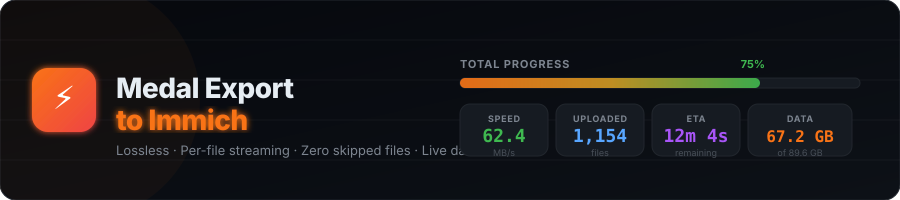
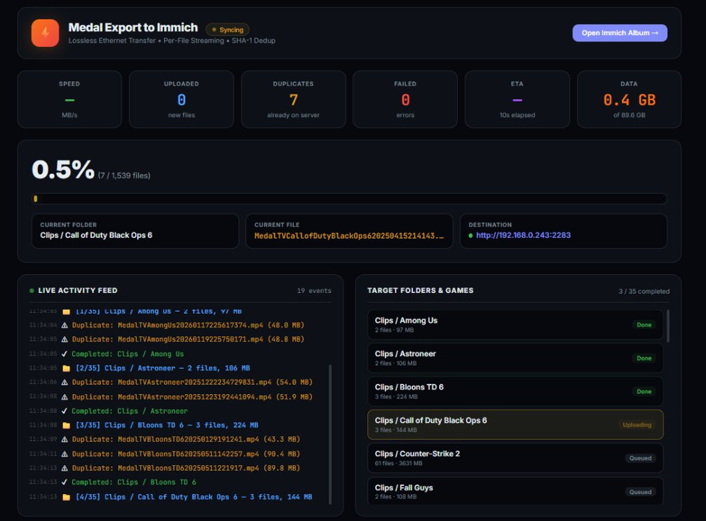

# Medal Export to Immich

<div align="center">



<br /><br />

**The fastest way to bulk-export all your [Medal.tv](https://medal.tv) gaming clips to a self-hosted [Immich](https://immich.app) server — zero quality loss, zero skipped files.**

[](https://python.org)
[](https://immich.app)
[](LICENSE)

---

🎮 **Auto-discovers** all Medal clips, edits & screenshots across all drives  
⚡ **Streams files** over Ethernet/LAN at wire speed — no re-encoding  
🔒 **SHA-1 deduplication** — never uploads the same file twice  
📊 **Real-time web dashboard** with live progress, speed metrics & activity feed  
🗂️ **Organizes everything** into a clean "Medal" album on Immich  

</div>

---

## 📸 Dashboard Preview

<div align="center">

</div>

---

## 🚀 Quick Start

### 1. Clone & Install

```bash
git clone https://github.com/nagatesz/MedalExportImmich.git
cd MedalExportImmich
pip install -r requirements.txt
```

### 2. Configure

Copy the example config and fill in your Immich details:

```bash
cp .env.example .env
```

Edit `.env`:

```env
IMMICH_URL=http://your-immich-server:2283
IMMICH_API_KEY=your-api-key-here
MEDAL_PATH=D:\Medal
```

> **How to get your Immich API key:**  
> Open Immich → Click your avatar (top-right) → **Account Settings** → **API Keys** → **New API Key**

### 3. Run

```bash
python app.py
```

Then open **[http://localhost:8765](http://localhost:8765)** in your browser to watch the live transfer dashboard.

---

## 📋 Features

| Feature | Description |
|---|---|
| **Auto-Discovery** | Scans `D:\Medal`, `C:\Medal`, and `%APPDATA%\Medal` for all clips |
| **Game-Organized Inventory** | Groups clips by game (Rocket League, Fortnite, Valorant, etc.) |
| **Lossless Transfer** | Uploads original MP4/MKV files byte-for-byte — no transcoding |
| **SHA-1 Deduplication** | Immich's built-in hash check ensures no duplicate uploads |
| **Album Organization** | All clips land in a dedicated "Medal" album |
| **Checkpoint Recovery** | If interrupted, re-run and it picks up exactly where it left off |
| **Live Web Dashboard** | Real-time progress bar, transfer speed, ETA, and scrolling activity feed |
| **Dual Network Support** | Tries direct LAN first, falls back to Tailscale/VPN automatically |
| **Per-File Streaming** | Each file updates the UI immediately — no batch freezing |

---

## ⚙️ Configuration

All configuration is done through environment variables (`.env` file):

| Variable | Required | Default | Description |
|---|---|---|---|
| `IMMICH_URL` | ✅ | — | Your Immich server URL (e.g. `http://192.168.1.100:2283`) |
| `IMMICH_API_KEY` | ✅ | — | API key from Immich account settings |
| `MEDAL_PATH` | ❌ | `D:\Medal` | Path to your Medal clips folder |
| `ALBUM_NAME` | ❌ | `Medal` | Name of the album to create in Immich |
| `DASHBOARD_PORT` | ❌ | `8765` | Port for the live web dashboard |
| `FALLBACK_URL` | ❌ | — | Secondary Immich URL (e.g. Tailscale IP) |

---

## 🏗️ Project Structure

```
MedalExportImmich/
├── app.py                  # Main entry — starts dashboard + sync engine
├── sync_engine.py          # Core upload engine (per-file streaming)
├── scanner.py              # Medal folder auto-discovery & inventory builder
├── dashboard.py            # Flask web server & HTML dashboard
├── config.py               # Configuration loader (.env)
├── requirements.txt        # Python dependencies
├── .env.example            # Example configuration
├── LICENSE                 # MIT License
├── README.md               # This file
└── assets/
    ├── banner.svg          # Repo banner
    └── dashboard-preview.png
```

---

## 🤝 Contributing

Pull requests are welcome! If you have Medal clips on macOS or Linux, help us add cross-platform path discovery.

---

## 📄 License

MIT — do whatever you want with it.

---

<div align="center">

<br />

Built with 💜 by [**nog**](https://github.com/nagatesz) & [**Claude Opus 4**](https://docs.anthropic.com/en/docs/about-claude/models)

<br />

</div>
